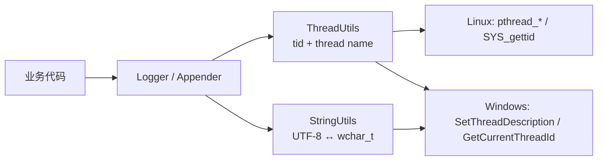
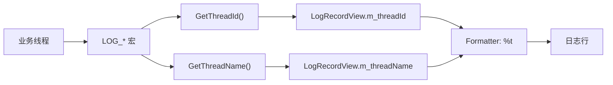

# 02 · 字符串编码与线程工具

> **系列**：CppGameServer 开发笔记
> **对应源码**：`CAS/Include/CAS/Utils/`、`CAS/Source/Utils/`、`Tests/TestThreadUtils.cpp`
> **前置**：[01 CMake 工程搭建](./CMake-Guide.md)

---

## 0. 一句话总结

本节给日志系统补上两块 **操作系统适配层**：

| 模块 | 解决什么 | 被谁使用 |
|------|---------|---------|
| `StringUtils` | UTF-8 ↔ `wchar_t` 转换，抹平平台编码差异 | Windows 下把系统宽字符转成项目内部 UTF-8 |
| `ThreadUtils` | 线程 ID + 线程名，抹平平台线程 API 差异 | 填充 `LogRecordView` 的 `m_threadId` / `m_threadName` |

本节不涉及日志业务逻辑，只解决"日志系统离不开、但 C++ 标准库给不了"的两个能力。

---

## 1. 本节定位

日志系统要输出这样一行内容：

```
2026-11-07 12:00:00.123456 [INFO] [net] [tid=12345] [worker-1] connect ok
                               ^      ^        ^            ^
                               |      |        |            +-- 线程名（ThreadUtils）
                               |      |        +-- 内核 TID（ThreadUtils）
                               |      +-- 日志器名
                               +-- 等级
```

其中 `tid` 和 `线程名` 有两个硬性要求：

1. **必须能和操作系统工具对齐**——`top -H`、`perf`、`gdb` 看到的线程标识要能对上日志；
2. **必须跨平台**——Linux 用 `pthread_*` 和 `syscall(SYS_gettid)`，Windows 用 `SetThreadDescription` 和 `GetCurrentThreadId`。

而 Windows 的线程名 API 返回的是 `wchar_t*`（UTF-16），项目内部统一使用 `std::string`（UTF-8），于是又引出字符编码转换的需求。



---

## 2. 源码清单

| 文件 | 可见性 | 职责 |
|------|--------|------|
| `CAS/Include/CAS/Utils/StringUtils.h` | 公开 | `StringUtils` 类声明（纯静态类） |
| `CAS/Source/Utils/StringUtils.cpp` | 内部 | UTF-8 编解码算法实现 |
| `CAS/Include/CAS/Utils/ThreadUtils.h` | 公开 | `GetThreadId` / `SetThreadName` / `GetThreadName` |
| `CAS/Source/Utils/ThreadUtils.cpp` | 内部 | 三平台实现 |
| `Tests/TestThreadUtils.cpp` | 测试 | 手动观测程序（非自动化测试） |

命名空间：`CAS`。头文件保护宏：`CAS_INCLUDE_CAS_UTILS_*`。

---

## 3. StringUtils

### 3.1 为什么需要它

C++ 标准库的 `<codecvt>` 已被废弃（C++17 deprecated，C++26 移除），`std::wstring_convert` 同样不可用；直接用系统 API（`MultiByteToWideChar` / `iconv`）又不可移植。

所以要么引入第三方库（ICU、utf8cpp），要么**自己写**。UTF-8 与 UTF-16/32 的互转规则本身不复杂，自己写反而最可控、零依赖。

### 3.2 核心背景：`wchar_t` 在不同平台不是一回事

| 平台 | `sizeof(wchar_t)` | 实际编码 | 特点 |
|------|------------------|---------|------|
| Windows | **2** | **UTF-16** | 一个 `wchar_t` 是一个 UTF-16 code unit，`> U+FFFF` 的字符需要**代理对** |
| Linux | **4** | **UTF-32** | 一个 `wchar_t` 就是一个完整码点 |
| macOS | 4 | UTF-32 | 同 Linux |

代码用两条编译期措施抹平差异：

```cpp
static_assert(sizeof(wchar_t) == 2 || sizeof(wchar_t) == 4,
              "StringUtils requires a UTF-16 or UTF-32 wchar_t");

if constexpr (sizeof(wchar_t) == 2) { /* UTF-16 分支 */ }
else                                { /* UTF-32 分支 */ }
```

- `static_assert`：出现第三种 `wchar_t` 宽度时**直接编译失败**，而不是运行时出错。
- `if constexpr`：编译期选分支，运行时零开销。

### 3.3 三个基础概念

#### 3.3.1 码点（Code Point）

Unicode 给每个字符分配的整数编号，合法范围 `0x0 ~ 0x10FFFF`。例如：

| 字符 | 码点 |
|------|------|
| `A` | `U+0041` |
| `中` | `U+4E2D` |
| `😀` | `U+1F600` |

#### 3.3.2 代理区与代理对（Surrogate Pair）

`0xD800 ~ 0xDFFF` 这段编号**不分配给任何字符**，专门给 UTF-16 用来表示 `> 0xFFFF` 的码点：

- 高代理：`0xD800 ~ 0xDBFF`
- 低代理：`0xDC00 ~ 0xDFFF`

**编码公式**（码点 → 代理对）：

```
code_point -= 0x10000
high = 0xD800 + (code_point >> 10)
low  = 0xDC00 + (code_point & 0x3FF)
```

**解码公式**（代理对 → 码点）：

```
code_point = 0x10000 + ((high - 0xD800) << 10) + (low - 0xDC00)
```

**举例**：`😀` = `U+1F600`

```
1F600 - 10000 = F600
high = D800 + (F600 >> 10) = D800 + 3D = D83D
low  = DC00 + (F600 & 3FF) = DC00 + 200 = DE00
→ UTF-16: D83D DE00
```

关键点：**代理码点在 UTF-8 和 UTF-32 中都是非法的**，只能出现在 UTF-16 内部。

#### 3.3.3 UTF-8 的四种字节布局

| 码点范围 | 字节数 | 二进制布局 |
|---------|--------|-----------|
| `0x00 ~ 0x7F` | 1 | `0xxxxxxx` |
| `0x80 ~ 0x7FF` | 2 | `110xxxxx 10xxxxxx` |
| `0x800 ~ 0xFFFF` | 3 | `1110xxxx 10xxxxxx 10xxxxxx` |
| `0x10000 ~ 0x10FFFF` | 4 | `11110xxx 10xxxxxx 10xxxxxx 10xxxxxx` |

**举例**：`中` = `U+4E2D`

```
U+4E2D = 0100 1110 0010 1101
三字节布局：1110xxxx 10xxxxxx 10xxxxxx
拆位：      0100      111000    101101
加前缀：    1110 0100  10 111000  10 101101
结果：      E4        B8        AD
```

所以一个汉字在 UTF-8 里占 **3 字节**。这解释了后文线程名 15 字节上限的实际影响。

### 3.4 编码：`AppendUtf8`

```cpp
void AppendUtf8(std::string& output, u32 code_point)
{
    if (code_point <= 0x7F)        { /* 1 字节 */ }
    else if (code_point <= 0x7FF)  { /* 2 字节 */ }
    else if (code_point <= 0xFFFF) { /* 3 字节 */ }
    else                            { /* 4 字节 */ }
}
```

就是照上面的表逐位拼接，没有分支技巧。

### 3.5 解码：`DecodeUtf8CodePoint` 的五层校验

解码必须**拒绝非法输入**，否则会把脏数据带进后续的字符串比较、日志、协议处理。代码做了五层校验：

| 层 | 校验内容 | 拒绝的输入 |
|----|---------|-----------|
| 1 | 首字节范围 | `0xC0`/`0xC1`（超长编码）、`0xF5+`（超出 `0x10FFFF`） |
| 2 | 续字节必须是 `10xxxxxx` | 断掉的序列、错位的序列 |
| 3 | 剩余长度是否足够 | 被截断的 UTF-8 |
| 4 | 码点是否小于该长度的最小值 | 超长编码（如 `C0 80` 表示 `U+0000`） |
| 5 | 是否为代理码点 / 超出 `0x10FFFF` | UTF-8 中非法的代理区 |

```cpp
// 首字节分类：从 0xC2 开始、到 0xF4 结束
if (first >= 0xC2 && first <= 0xDF)      { continuation_count = 1; minimum = 0x80; }
else if (first >= 0xE0 && first <= 0xEF) { continuation_count = 2; minimum = 0x800; }
else if (first >= 0xF0 && first <= 0xF4) { continuation_count = 3; minimum = 0x10000; }
else return false;
```

> **为什么从 `0xC2` 开始**：`0xC0` / `0xC1` 只能表示 `< 0x80` 的码点，属于超长编码，是历史上常见的绕过过滤的攻击手法。
>
> **为什么到 `0xF4` 结束**：`0xF5` 以上会解出 `> 0x10FFFF` 的码点，超出 Unicode 范围。

### 3.6 为什么 `noexcept` 还要 `try/catch`

```cpp
std::string StringUtils::WStringToString(std::wstring_view text) noexcept
{
    try
    {
        std::string result;
        result.reserve(text.size());   // ← 可能抛 bad_alloc
        ...
    }
    catch (...)
    {
        ASSERT_NOEFFECT2(false, "宽字符串转换为 UTF-8 时发生异常");
        return {};
    }
}
```

- `noexcept` 是对外**承诺**：基础库不能把异常抛给业务代码。
- 但内部确实会分配内存，`bad_alloc` 可能发生；一旦穿出 `noexcept` 函数，程序直接 `std::terminate`。
- 所以组合是：**对外 `noexcept` + 对内 `try/catch` + 失败时断言并返回空串**。

配套断言宏：

| 宏 | 失败行为 |
|----|---------|
| `ASSERT_RETVAL2(cond, val, msg)` | 断言 + `return val` |
| `ASSERT_NOEFFECT2(cond, msg)` | 只断言，不返回 |

注意：`ASSERT_RETVAL2` 的 `return` 在断言**之后无条件执行**，所以 Release 下 `assert` 被 `NDEBUG` 编译掉后，函数依然返回 `{}`——校验不会失效，只是不再中止程序。

### 3.7 为什么写成纯静态类

```cpp
class CAS_API StringUtils final
{
public:
    StringUtils() = delete;
    [[nodiscard]] static std::string WStringToString(std::wstring_view text) noexcept;
    [[nodiscard]] static std::wstring StringToWString(std::string_view text) noexcept;
};
```

| 写法 | 目的 |
|------|------|
| `final` | 工具类没有多态价值，禁止继承 |
| `StringUtils() = delete` | 禁止实例化，误用在**编译期**报错 |
| `static` 成员 | 无状态，纯算法 |
| `CAS_API` 挂在类上 | 整类导出，比逐个函数加宏简洁 |
| `[[nodiscard]]` | 返回值不可忽略，避免"调了但没用结果" |

### 3.8 使用示例

```cpp
#include <CAS/Utils/StringUtils.h>

// Linux 下 wchar_t 是 UTF-32
std::wstring wide = CAS::StringUtils::StringToWString("花间客");
std::string  utf8 = CAS::StringUtils::WStringToString(wide);
```

---

## 4. ThreadUtils

### 4.1 为什么不用 `std::thread::id`

`std::thread::id` 是**不透明类型**，各标准库实现不同，打印出来的值与操作系统线程无关。排查问题时它无法和任何工具对齐：

| 工具 | 需要的标识 |
|------|-----------|
| `top -H -p <pid>` | 内核 TID |
| `ps -T -p <pid>` | 内核 TID |
| `perf record -t <tid>` | 内核 TID |
| `gdb` → `info threads` | 内核 TID |
| `/proc/<pid>/task/<tid>/comm` | 线程名 |

日志里打内核 TID，才能和这些工具**同一口径**。

### 4.2 `GetThreadId`：三平台实现

```cpp
u64 GetThreadId() noexcept
{
#if defined(__linux__)
    static thread_local const u64 THREAD_ID = static_cast<u64>(::syscall(SYS_gettid));
#elif defined(_WIN32)
    static thread_local const u64 THREAD_ID = static_cast<u64>(::GetCurrentThreadId());
#else
    static thread_local const u64 THREAD_ID =
        static_cast<u64>(std::hash<std::thread::id>{}(std::this_thread::get_id()));
#endif
    return THREAD_ID;
}
```

| 平台 | API | 说明 |
|------|-----|------|
| Linux | `syscall(SYS_gettid)` | 内核 TID，与 `top -H` 一致；glibc 2.30+ 也可用 `gettid()` |
| Windows | `GetCurrentThreadId()` | 系统线程 ID（DWORD） |
| 其他 | `std::hash<std::thread::id>` | 退化方案，仅保证进程内唯一 |

**`static thread_local const` 的意义**：每个线程只执行一次系统调用，之后直接返回缓存值（函数调用 + 系统调用在大日志量下是真实开销）。

### 4.3 线程名：Linux 与 Windows 是两套模型

| | Linux | Windows |
|---|-------|---------|
| 设置 | `pthread_setname_np` | `SetThreadDescription` |
| 获取 | `pthread_getname_np` | `GetThreadDescription` |
| 长度限制 | **16 字节含 `\0`，即最多 15 字节** | 基本无此限制（Win10 1607+） |
| 字符宽度 | UTF-8 字节串 | **UTF-16 宽字符** |
| 内存管理 | 调用方提供缓冲区 | 系统分配，必须 `LocalFree` |

### 4.4 Linux 的 15 字节限制与截断处理

Linux 内核 `TASK_COMM_LEN` = 16，包含结尾 `\0`，所以**有效字节只有 15 个**。超过会被内核直接截断。

截断有个副作用：如果第 15 个字节正好落在一个多字节 UTF-8 字符中间，内核里就会留下**非法 UTF-8**。所以本项目做了**按字符边界截断**：

```cpp
std::array<char, 16> native_name{};
std::size_t name_size = std::min(name.size(), native_name.size() - 1);

// 截断时回退到 UTF-8 字符边界，避免把一个多字节字符切成两半
if (name_size < name.size())
{
    while (name_size > 0 &&
           (static_cast<unsigned char>(name[name_size]) & 0xC0U) == 0x80U)
    {
        --name_size;
    }
}

std::memcpy(native_name.data(), name.data(), name_size);
(void)pthread_setname_np(pthread_self(), native_name.data());
```

原理：UTF-8 的**续字节**形如 `10xxxxxx`，往回退直到遇到首字节，就回到了字符边界。

**举例**：

| 名字 | 字节数 | 内核侧结果 |
|------|--------|-----------|
| `main_thread` | 11 | 完整 |
| `花间客真帅` | 5 × 3 = 15 | 完整（恰好卡满） |
| `磐石磐石坚如磐石` | 8 × 3 = 24 | 截断为 `磐石磐石坚`（15 字节） |
| `son-thread-long-name` | 20 | 截断为 `son-thread-long`（15 字节） |

### 4.5 Windows：`LocalFree` 与宽字符转换

```cpp
PWSTR raw_name = nullptr;
if (FAILED(::GetThreadDescription(::GetCurrentThread(), &raw_name)))
{
    return {};
}

// GetThreadDescription 用 LocalAlloc 分配，必须 LocalFree 释放
const std::unique_ptr<wchar_t, LocalFreeDeleter> native_name(raw_name);
return StringUtils::WStringToString(std::wstring_view(native_name.get()));
```

三个要点：

1. **所有权**：缓冲区由系统 `LocalAlloc` 分配，必须用 `LocalFree` 释放——所以用 `unique_ptr` + 自定义删除器做 RAII；
2. **编码**：返回 `wchar_t*`（UTF-16），项目内部要 UTF-8，所以调用 `StringUtils::WStringToString`；
3. **编译优化**：Windows 头文件前置定义 `WIN32_LEAN_AND_MEAN` 与 `NOMINMAX`：

```cpp
#define WIN32_LEAN_AND_MEAN  // 不包含 shell/图形界面等冷门 API
#define NOMINMAX             // 防止 windows.h 定义 min/max 宏
#include <windows.h>
```

### 4.6 `thread_local` 线程名缓冲

```cpp
constexpr std::string_view DEFAULT_THREAD_NAME = "UNKNOWN";
thread_local std::string t_thread_name = GetNativeThreadName();
```

- **每线程一份**：天然免锁，不需要互斥量。
- **懒初始化**：C++ 保证线程局部变量在该线程**首次访问**时才初始化，因此每个线程第一次调用时才会去读 OS 名字。
- **可重置**：`SetThreadName("")` 会重新读取原生名；读不到则用 `"UNKNOWN"`。

`SetThreadName` 的语义：

```cpp
void SetThreadName(std::string name)
{
    if (name.empty())
    {
        ASSERT_NOEFFECT2(false, "you passed empty thread name");
        std::string native_name = GetNativeThreadName();
        t_thread_name = native_name.empty() ? std::string(DEFAULT_THREAD_NAME)
                                            : std::move(native_name);
        return;
    }
    t_thread_name = std::move(name);
    SetNativeThreadName(t_thread_name);
}
```

- 参数按值 `std::string`：调用方可 `move` 进来，最后 `move` 到成员，少一次拷贝。
- 空串 = 重置，不是错误。

> ⚠️ Debug 构建下，`SetThreadName("")` 会触发 `assert(false)` 直接中止。Release（`NDEBUG`）下才会正常执行重置。这是测试程序里用 `#if defined(NDEBUG)` 包住该步骤的原因。

### 4.7 `GetThreadName` 的生命周期陷阱

```cpp
std::string_view GetThreadName() noexcept { return t_thread_name; }
```

返回的是指向 **thread_local `std::string`** 的非拥有视图，有两个风险：

| 场景 | 后果 |
|------|------|
| 同线程保存了 view，随后调用 `SetThreadName` | `std::string` 重新分配 → view 悬垂 |
| 跨线程保存了 view，源线程退出 | TLS 析构 → view 悬垂 |

**结论**：同步日志（记录当场用完）可以安全使用；**异步日志必须把名字拷贝成拥有型字符串**。

---

## 5. 与日志系统的衔接

`LogRecordView` 中两个字段由本节工具填充：

```cpp
struct LogRecordView
{
    ...
    std::uint64_t     m_threadId = 0;   // ← GetThreadId()
    std::string_view  m_threadName;     // ← GetThreadName()
    ...
};
```



**异步日志注意事项**：`m_threadName` 是 `string_view`，一旦记录被投递到别的线程的队列，源线程的 TLS 可能已经变化或销毁。投递前必须拷贝。

---

## 6. 测试程序 `Tests/TestThreadUtils.cpp`

### 6.1 它是什么

**不是自动化测试**，而是**手动观测程序**：在已知时间点改线程名并 `sleep`，让你用外部工具观察内核里的真实状态。

### 6.2 步骤与预期

| 步骤 | 操作 | C++ 侧（`GetThreadName`） | 内核侧（`top -H`） | 演示点 |
|------|------|--------------------------|-------------------|--------|
| 1 | 初始状态 | `TestThreadUtils`（15B） | 同名 | 进程名，恰好卡满上限 |
| 2 | `main_thread` | `main_thread`（11B） | 同名 | 正常一致 |
| 3 | `花间客真帅` | 15B | 同名 | 边界值，刚好不截断 |
| 4 | `磐石磐石坚如磐石` | 24B | `磐石磐石坚` | **截断发生** |
| 5 | 新建 worker | 继承创建者名字 | `磐石磐石坚` | 新线程继承创建者的 `comm` |
| 6 | `son-thread-long-name` | 20B | `son-thread-long` | 截断发生 |
| 7 | `SetThreadName("")` | 原生名 | 同名 | 重置（仅 Release） |

### 6.3 如何观察

```bash
cd ~/WorkStation/CppGameServer
cmake -S . -B build
cmake --build build -j$(nproc)
./build/Tests/TestThreadUtils
```

程序会打印 pid，另开终端：

```bash
top -H -p <pid>                  # 按 H 展开线程，看 COMMAND 列
ps -T -p <pid>                   # 看 SPID / CMD
cat /proc/<pid>/task/*/comm      # 直接读内核 comm
```

验证第 7 步需要 Release 构建：

```bash
cmake -S . -B build-release -DCMAKE_BUILD_TYPE=Release
cmake --build build-release -j$(nproc)
./build-release/Tests/TestThreadUtils
```

### 6.4 为什么它不注册到 `ctest`

- 总耗时 90 秒以上；
- 依赖人在外部终端观察，无法自动判定成功/失败；
- Debug 下第 7 步会触发断言。

`Tests/CMakeLists.txt` 只构建可执行文件，不调用 `add_test`。

---

## 7. 常见坑

| # | 坑 | 说明 |
|---|----|------|
| 1 | 把 `wchar_t` 当固定宽度用 | Windows 2 字节 / Linux 4 字节，必须先判 `sizeof` |
| 2 | 在 UTF-8 中接受代理码点 | `U+D800~U+DFFF` 在 UTF-8/UTF-32 中非法 |
| 3 | 忽略超长编码 | `C0 80` 能解出 `U+0000`，必须用最小值校验拒绝 |
| 4 | 假设线程名能存任意长度 | Linux 只有 15 字节，且截断可能切断多字节字符 |
| 5 | 把 `GetThreadName()` 的 view 存起来跨线程用 | TLS 视图会悬垂 |
| 6 | 用 `std::thread::id` 打日志 | 无法和 `top -H` / `perf` / `gdb` 对齐 |
| 7 | `noexcept` 函数里直接分配 | `bad_alloc` 穿出 → `std::terminate`，必须内部捕获 |
| 8 | 忘记 `LocalFree` | Windows 线程名缓冲区泄漏 |

---

## 8. 知识点清单

- [ ] `wchar_t` 在 Windows / Linux 的宽度与编码差异
- [ ] 码点、代理区、代理对的换算公式
- [ ] UTF-8 四种字节布局与手工编码（`中` → `E4 B8 AD`）
- [ ] UTF-8 解码的五类校验：首字节、续字节、长度、超长编码、代理码点
- [ ] `noexcept` + `try/catch` + 断言 的组合语义
- [ ] 纯静态工具类的写法（`final` + `= delete`）
- [ ] 内核 TID vs `std::thread::id`
- [ ] Linux / Windows 线程名 API 与限制
- [ ] `thread_local` 的懒初始化与生命周期
- [ ] `string_view` 返回值的悬垂风险

---

## 9. 后续

- 前端日志宏（`LOG_INFO` 等）与 `LogRecordView` 的构造
- 异步日志队列（涉及 `string_view` 的拷贝时机）
- 日志文件滚动（按大小/时间）

---

*本文档基于 `CAS/Utils` 模块当前实现整理，后续代码变更请同步更新。*
