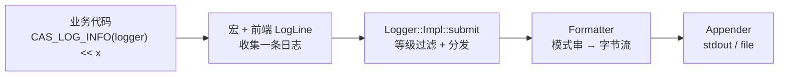
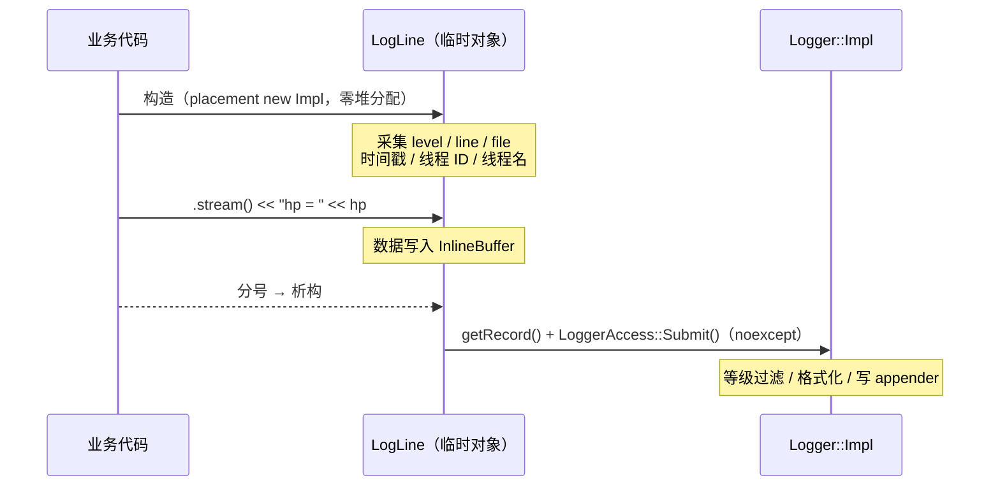

# 08 · 利用 RAII 机制进行日志采集

> **系列**：CppGameServer 开发笔记
> **对应源码**：`CAS/Include/CAS/Logger/LogLine.h`、`CAS/Source/Logger/LogLine.cpp`
> **前置**：[07 字符串编码与线程工具](./07-字符串编码与线程工具.md)（`LogRecordView` 里的线程 ID / 线程名由它填充）

---

## 0. 一句话总结

日志前端要同时满足两个互相冲突的诉求：

1. 用户想用 `<<` **链式拼接任意类型**，写出 `LOG_INFO(logger) << "hp = " << hp;`；
2. 这个拼接过程**随时可能中断**——表达式抛异常、`if` 提前 `return`、循环里 `break`。

解法是把"一条日志"做成一个**栈上临时对象**：

| 时刻 | 动作 |
|------|------|
| 构造 | 开始收集（准备流缓冲、记下 level / 行号 / 文件） |
| 用户 `<< a << b` | 逐段写进内部缓冲 |
| 分号处析构 | **提交**（组装 `LogRecordView` → `Logger::Impl::submit`） |

一句话：**构造即开始，析构即提交；提交这件事，只有析构函数绕不过去。**

---

## 1. 本节定位

日志系统的分层：



本节只讲**最前面那一层**：怎么把"一串 `<<` 表达式"变成一条完整的 `LogRecordView`。

它不负责格式化，也不负责写盘——那两件事在 `Logger::Impl::submit` 里（见 `CAS/Source/Logger/Logger.cpp`）。

---

## 2. 源码清单

| 文件 | 可见性 | 职责 |
|------|--------|------|
| `CAS/Include/CAS/Logger/LogLine.h` | 公开（但属 `CAS::Detail`） | `LogLine` 类 + `LogPrintf` 声明，全部设计注释在这里 |
| `CAS/Source/Logger/LogLine.cpp` | 内部 | `Impl` 定义、就地构造/析构、`getRecord` 组装、`printf` 单趟格式化 |
| `CAS/Include/CAS/Logger/Log.h` | 公开 | **业务唯一应该直接用到的入口**：`CAS_LOG_*` / `CAS_LOG_FMT_*` 宏 + `CAS_LOG_ROOT` / `CAS_LOG_NAME` |
| `Tests/TestLog.cpp` | 测试 | 手动观测程序：5 等级 × 流式/printf、类型拼接、多 sink（见第 6 节） |

命名空间 `CAS::Detail`（`LogLine` / `LogPrintf`），宏在全局作用域；头文件保护宏分别是
`CAS_INCLUDE_CAS_LOGGER_LOG_LINE_H` 与 `CAS_INCLUDE_CAS_LOGGER_LOG_H`。

**调用方式**（宏已落地，业务代码不再需要手写 `Detail::LogLine`）：

```cpp
CAS_LOG_INFO(CAS_LOG_NAME("net")) << "connect ok, fd = " << fd;
CAS_LOG_FMT_WARN(CAS_LOG_ROOT(), "slow query: %s took %d ms", sql, cost_ms);
```

---

## 3. 一次日志调用的完整生命周期



三个关键时机：

1. **构造**：还不知道消息内容，但"谁、什么等级、哪一行、什么时候、在哪个线程"全都在这一刻定死；
2. **`.stream()` 之后**：用户的 `<<` 全部落到 `InlineBuffer`；
3. **析构**：临时对象在"完整表达式"结束（分号）时销毁，此刻消息已拼完整。

---

## 4. 设计决策逐条

### 4.1 为什么是 RAII，而不是 `Log(...)` 函数或显式 `submit()`

这是本笔记最核心的一条，**两个层面的原因缺一不可**。

#### 原因一（语法层面）：显式 `submit()` 根本写不出来

用户写的是：

```cpp
CAS_LOG_INFO(logger) << "hp = " << player.GetHp();
```

宏只占据这行的**开头**，后面 `<< "hp = " << player.GetHp()` 是用户自己写的**尾巴**，宏管不到。所以宏展开后必须是一条**表达式**，让用户的尾巴能续上去。

看看另外三种写法怎么失败：

| 写法 | 展开结果 | 问题 |
|------|---------|------|
| `do { LogLine l(...); l.stream() } while (0)` | `do{...}while(0) << "hp = "` | **块式宏是语句**，`<<` 只能作用于表达式 → 编译错误 |
| `if (!shouldLog) {} else LogLine(...).stream()` | 合法，但提交只能靠析构 | 宏无法在用户尾巴之后追加 `.submit()` |
| `LogLine __l(...); __l.stream()` | `LogLine __l(...); __l.stream() << ...` | 展开成**两条语句**：① 没人知道变量名 `__l`，`submit()` 永不调用；② 放进 `if (c) LOG << x;` 里，`if` 只管辖第一条，第二条无条件执行 |

所以可行形态只有一种：**宏产出一个临时对象，提交挂在它的析构上**。

#### 原因二（语义层面）：即使写出来了，也会漏日志

假设真的有具名对象 + 手动提交：

```cpp
LogLine log_line(logger, level, __LINE__, __FILE__);
log_line.stream() << "hp = " << hp;

if (hp == 0)
    return;              // ← 提前返回，后面的 submit() 被跳过 → 日志静默消失

log_line.submit();       // 只有走到这里才提交
```

`return` / `throw` / `break` / `continue` / `goto` 都会跳过那一行。

而析构函数是**编译器在每条退出路径上自动插入**的：

```cpp
{
    LogLine log_line(logger, level, __LINE__, __FILE__);
    log_line.stream() << "hp = " << hp;
    if (hp == 0)
        return;          // 编译器在这里插入 ~LogLine() → 照样提交
}
```

异常栈展开时同样会执行（见 4.6）。

#### 原因三（时机刚好）

C++ 规定临时对象在**完整表达式结束时**销毁，也就是分号处。此刻 `<< a << b` 全部写完，缓冲区里是完整消息，不会出现"打了一半的日志"。

### 4.2 为什么 Impl 不放堆上：就地 Pimpl（SBO）

常规 Pimpl 长这样：

```cpp
class LogLine
{
private:
    std::unique_ptr<Impl> m_impl;   // 每条日志一次 new + 一次 delete
};
```

日志是**热路径**，这个 `new/delete` 代价很高：

| 问题 | 说明 |
|------|------|
| 频率 | 一帧几百条日志时，堆分配直接成为帧率杀手 |
| 锁竞争 | `operator new` 内部有 arena 锁，多线程打日志在这把锁上串行化 |
| 碎片 / cache | 分配释放交替进行，内存碎片 + cache miss |

所以改成**在对象内部预留原始存储**：

```cpp
private:
    struct Impl;                                        // 只有声明
    static constexpr std::size_t LOG_LINE_IMPL_SIZE = 1024;
    alignas(std::max_align_t) std::byte m_implStorage[LOG_LINE_IMPL_SIZE];
```

`LogLine` 是栈上临时对象，`Impl` 直接构造在这块存储里 —— **一次日志零堆分配**。

| | `unique_ptr<Impl>` | 就地存储 |
|---|---|---|
| 每条日志堆分配 | 1 次 new + 1 次 delete | **0** |
| 实现可见性 | 完全隐藏 | 完全隐藏（`Impl` 只在 .cpp 定义） |
| `sizeof(LogLine)` | 8 | ≈1024（栈占用） |
| 实现变大时 | 无影响 | 超过缓冲区 → 编译期 `static_assert` 报错 |

这是明确的**空间换时间**：栈空间便宜（默认线程栈几 MB），堆分配贵。

#### 4.2.1 什么才决定"能不能塞进定长存储"

只有一个条件：**`sizeof(Impl)` 是编译期常量，且 `≤ LOG_LINE_IMPL_SIZE`**。三个前提：

| 前提 | 说明 | 不满足的后果 |
|------|------|-------------|
| `Impl` 是**完整类型** | 定义在 .cpp 里，`sizeof` / `alignof` 才可用；头文件里只有 `struct Impl;` | 不完整类型不能 `sizeof`，也算不出数组要多大 |
| 大小**可控** | 成员全是定长值类型（引用、整型、`string_view`、`time_point`、`InlineBuffer`、`streambuf`、`ostream`），没有变长数组、没有内嵌大对象 | 超出缓冲区 → 越界写穿栈 |
| 能**原地构造/析构** | `construct_at` + `destroy_at`，调用点是静态类型 | 需要虚析构才能正确销毁 |

两个常见误解：

- **"含虚函数就不能定长"** —— 错。含虚函数的类型大小同样编译期可知，只是多 8 字节 vptr；需要虚析构的场景是"通过基类指针 `delete`"，而我们用 `impl.~Impl()` 静态调用。
- **"不能有堆对象"** —— 也错。持有 `std::string` / `std::vector` / `unique_ptr` 只占固定几个指针，**不影响 `sizeof(Impl)`**。本项目 `InlineBuffer` 里就有一个 `std::vector<char>`，消息超长时它照样在堆上。
  **"对象本身放哪（栈内定长存储）"与"内容放哪（堆）"是两个正交问题**：SBO 消除的是"为了 Impl 本身而做的那一次 `new/delete`"，不是"一切堆分配"。

### 4.3 `alignas(std::max_align_t)` 那一行到底在做什么

```cpp
alignas(std::max_align_t) std::byte m_implStorage[LOG_LINE_IMPL_SIZE];
```

#### 4.3.1 `alignof` 是什么

> `alignof(T)` 表示 **T 的对象的起始地址，必须是它的整数倍**。

```cpp
alignof(char)             == 1    // 1 的倍数 = 不受限制
alignof(std::byte)        == 1
alignof(int)              == 4    // 地址必须是 4 的倍数
alignof(double)           == 8
alignof(void*)            == 8    // 64 位平台
alignof(std::max_align_t) == 16   // x86-64 上通常
```

注意它说的是**地址能被几整除**，不是"占几个字节"。

#### 4.3.2 为什么 `std::byte` 是 1

`std::byte` 本质是 `enum class byte : unsigned char`，就是**一个字节**。CPU 用一条 `mov al, [addr]` 就能取到，任何地址都能完成，所以 ABI 给它的对齐是 1——**完全不限制**。

而**数组的对齐继承元素对齐**：

```cpp
alignof(std::byte[1024]) == 1
```

#### 4.3.3 `alignof == 1` 会把存储放到哪

成员偏移由**成员自己的对齐要求**决定，`alignof == 1` 不需要任何填充：

```cpp
struct Wrapper
{
    char      m_tag;                  // 偏移 0
    std::byte m_storage[16];          // 偏移 1 ← 不需要 padding
};
```

```
偏移:   0      1                                  17
        ┌──────┬───────────────────────────────────┐
        │ tag  │ m_storage[16]                     │
        └──────┴───────────────────────────────────┘
地址:  0x1000 0x1001 .................... 0x1011
              ↑ 奇数地址，不是 16 的倍数
```

加上 `alignas(std::max_align_t)` 之后：

```
偏移:   0      1                             16                 32
        ┌──────┬──────────────────────────┬───────────────────┐
        │ tag  │ padding（15 字节）       │ m_storage[16]     │
        └──────┴──────────────────────────┴───────────────────┘
地址:  0x1000 0x1001                    0x1010               0x1020
                                      ↑ 一定是 16 的倍数
```

`alignas` **不改变对象语义，只约束"这块内存放在哪个地址"**，代价是结构体变大。

#### 4.3.4 为什么"16 → 1"会出问题

`Impl` 里有 `std::ostream`、`std::streambuf` 子对象、`std::vector` 的三个指针、`Logger&`——这些成员要求 **8 或 16 字节对齐**。把它们放到 `0x1001` 上是**未定义行为**，后果分四层：

| 层面 | 后果 |
|------|------|
| **标准** | UB：编译器不需要产生任何正确结果，"今天能跑"不作数 |
| **硬件** | x86-64 普通 `mov` 容忍非对齐（拆两次访问、变慢）→ **问题潜伏**；SSE 的 `movaps`/`movdqa` 要求 16 对齐 → `#GP` 崩溃；ARM64 的 `ldaxr`/`stxr`（`shared_ptr` 引用计数是 `std::atomic`）必须对齐 → 异常；ARMv7 / 部分 RISC-V 连普通访问都 SIGBUS |
| **编译器** | 最阴：`alignof(Impl) == 16` 是它读到的"事实"，于是敢用对齐指令、敢整块拷贝、敢自动向量化。`-O0` 一直正常，开 `-O2` 突然段错误 |
| **工具** | `-fsanitize=alignment` 当场报 `constructor call on misaligned address ... requires 16 byte alignment` |

自己复现（故意偏移 1 字节）：

```cpp
#include <cstddef>
#include <new>

struct Impl { void* p = nullptr; long double v = 0; };

int main()
{
    char buffer[sizeof(Impl) + 1];
    auto* impl = ::new (static_cast<void*>(buffer + 1)) Impl{};   // 故意不对齐
    impl->~Impl();
}
```

```bash
g++ -std=c++20 -g -fsanitize=alignment,undefined t.cpp && ./a.out
```

#### 4.3.5 为什么 `std::max_align_t` 正好够

`std::max_align_t` 是**平台最大标量对齐**，标准还保证 `operator new` / `malloc` 返回的地址一定是它对齐的。所以这行的语义是：

> **让这块存储的对齐，和 `new` 出来的一块内存一样干净。**

任何只要满足标准对齐要求的类型都能安全落位。

**边界**：它**只覆盖到平台最大标量对齐**。若 `Impl` 将来出现 `alignas(32)` / `alignas(64)` 的成员（SIMD、cache line），就不够了，得改成 `alignas(Impl)`。这种情况由 4.4 的 `static_assert` 在编译期拦下。

### 4.4 三道编译期安全网

缓冲区大小是**手写常量**，与 `Impl` 真实大小之间没有任何机制保证一致，必须靠 `static_assert`（都在构造函数体内，因为成员是 private）：

```cpp
static_assert(sizeof(Impl) <= LOG_LINE_IMPL_SIZE,
              "LogLine::Impl 超出缓冲区，请增大 LOG_LINE_IMPL_SIZE");

static_assert(alignof(Impl) <= alignof(std::max_align_t),
              "LogLine::Impl 的对齐要求超过 std::max_align_t，需改用 alignas(Impl)");

static_assert(std::is_nothrow_destructible_v<Impl>,
              "~LogLine() 声明为 noexcept，Impl 的析构也必须是 nothrow");
```

| 断言 | 拦住什么 | 不拦的后果 |
|------|---------|-----------|
| `sizeof` | `Impl` 长大后越界 | placement new **写穿**缓冲区，踩掉相邻栈变量，极难定位 |
| `alignof` | 出现更高对齐的成员 | 运行时未对齐访问 → UB / 崩溃 |
| `is_nothrow_destructible` | 某个成员的析构可能抛 | 运行时在栈展开中 terminate |

第三条特别值得一提：`noexcept` 只约束**行为**，不约束**编译**。少了这条断言，`~LogLine() noexcept` 的契约只能靠"运行时炸给你看"来兑现。

### 4.5 为什么删除拷贝和移动

```cpp
LogLine(const LogLine&)            = delete;
LogLine& operator=(const LogLine&) = delete;
LogLine(LogLine&&)                 = delete;
LogLine& operator=(LogLine&&)      = delete;
```

对象里是一块**未类型化的字节存储**，编译器生成的拷贝构造只会**按位复制**：


- 深拷贝要求"复制构造一个 `Impl`"，而 `std::ostream` 本身**不可拷贝**，语义不存在；
- 它本来就是宏里的临时量，**没有复制或移动的需求**；
- 移动同样危险：按位搬走之后，原对象的 `Impl` 仍指向自己的存储，析构时二次提交。

所以四个入口全堵死，让误用在编译期暴露。

### 4.6 为什么析构必须 `noexcept`：栈展开

#### 4.6.1 什么是栈展开

异常从 `throw` 点向外传播时，从 `throw` 点到最近的 `catch` 之间的**所有自动存储期对象按构造逆序析构**，这个过程叫**栈展开（stack unwinding）**。

```cpp
void f()
{
    std::string a;                      // 构造 1
    Foo         b;                      // 构造 2
    throw std::runtime_error("x");      // 抛
}   // 展开：先析构 b，再析构 a，然后交给上层 catch
```

`throw` 之后的语句一行都不会执行，但 `a`、`b` 的析构**一定执行**——否则资源就泄漏了。RAII 全靠这个机制成立。

`LogLine` 是临时对象，所以「表达式抛异常」时它的析构依然执行：

```cpp
CAS_LOG_INFO(logger) << "hp = " << player.MightThrow();
//                                ↑ 这里抛 → LogLine 的析构在展开过程中被调用
```

此时**已经有一个异常在飞行中（in flight）**，这就是注释里"可能处于栈展开过程"的含义。

#### 4.6.2 为什么这要求 `noexcept`

C++ 硬性规则：**析构函数在栈展开期间抛出异常 → `std::terminate()` 立刻终止进程**。

语言无法同时处理两个异常，第二个没有任何地方能接，标准直接选择 abort。

而 `LogLine` 的析构恰恰是**唯一真正干活的地方**，它要格式化、拼缓冲、加 `shared_mutex`、调 `write()`——全都"理论上可能失败"。所以这不是"顺手加个 `noexcept`"，而是**必须把一条可能失败的重活塞进一个绝对不能失败的函数里**。

#### 4.6.3 这个 `noexcept` 靠什么成立

`noexcept` 只是声明，真正让它成立的是两层：

```
~LogLine() noexcept                       ← 第 1 层：契约（析构本身零分配、零 IO）
  └─ LoggerAccess::Submit(...)            ← 第 2 层：Logger::Impl::submit 内部 try/catch，
       → Logger::Impl::submit                格式化与写盘的异常在这里被吞掉
  └─ std::destroy_at(&impl)               ← vector / ostream 的析构本身 nothrow
```

```cpp
// Logger.cpp：异常在这里被吃掉，只丢这一条日志
try
{
    Detail::FormattedRecordBuffer formatted_record;
    m_formatter->format(record, formatted_record);
    for (const AppenderPtr& appender : m_appenders)
    {
        Detail::AppenderAccess::Append(appender, record.m_level, formatted_record.view());
    }
}
catch (...)
{
    // 日志系统绝不允许把异常抛回业务侧
}
```

设计取舍非常明确：

- **丢一条日志** = 可接受的降级（规范 7.1：资源失败 → 记录并降级）
- **terminate 整个进程** = 不可接受。日志库是横切基础设施，不能自己变成故障源

### 4.7 为什么 `stream()` 返回 `std::ostream&`，而不是 `LogLine& operator<<`

日志要支持任意类型（`int`、`double`、C 字符串、`std::string`、自定义 `Vector3`……）。成员 `operator<<` 只有写成**函数模板**才能做到——非模板重载无法穷举，也永远支持不了调用方的自定义类型。

```cpp
// 被否掉的方案
template <typename T>
LogLine& operator<<(const T& value)
{
    m_stream << value;      // ← 要求 Impl 的完整定义
    return *this;
}
```

模板一旦出现，函数体就必须在头文件里（模板在**每个调用点**现场实例化，只有声明会链接错误；显式实例化又要求预先枚举所有类型，而类型集合是开放的）。连锁后果：

| 后果 | 说明 |
|------|------|
| Pimpl 失效 | `m_stream << value` 需要完整 `Impl`，头文件里不能再是 `struct Impl;` |
| 编译依赖爆炸 | `<ostream>` / `<streambuf>` / `<vector>` 进每个打日志的 .cpp，改 Impl 全量重编 |
| 代码膨胀 | 每种类型 × 每个调用点各一份实例化（内联后更明显） |
| 重载打架 | 会与用户自由的 `operator<<` 竞争；`LOG << std::endl` 这类函数名还会让推导失败，需要额外重载 |

返回 `std::ostream&` 后，`<<` 全部走标准库**已有的**重载（大多是普通成员函数，编译期绑定，没有新实例化），`Impl` 继续藏在 .cpp 里。

> **一处常见误解**：`std::ostream` 的写入最终仍要经过 `std::streambuf` 的虚函数（`xsputn` / `overflow`，见 `CAS/Include/CAS/Logger/Buffer.h`）。**这次虚调用两个方案都有**，返回 `ostream&` 并没有省掉它——省掉的是模板实例化和头文件依赖。

---

## 5. 关键实现

### 5.1 就地构造 / 析构提交

```cpp
LogLine::LogLine(Logger& logger, LogLevel::Level level, u32 line,
                 std::string_view file_name) noexcept
{
    static_assert(sizeof(Impl) <= LOG_LINE_IMPL_SIZE, "...");
    static_assert(alignof(Impl) <= alignof(std::max_align_t), "...");
    static_assert(std::is_nothrow_destructible_v<Impl>, "...");

    std::construct_at(reinterpret_cast<Impl*>(m_implStorage), logger, level, line, file_name);
}

LogLine::Impl& LogLine::getImpl() noexcept
{
    return *std::launder(reinterpret_cast<Impl*>(m_implStorage));
}

LogLine::~LogLine() noexcept
{
    Impl& impl = getImpl();
    LoggerAccess::Submit(impl.m_logger, impl.getRecord());   // 提交
    std::destroy_at(&impl);                                  // 再销毁
}

std::ostream& LogLine::stream() noexcept
{
    return getImpl().m_stream;
}
```

| 要点 | 原因 |
|------|------|
| `std::construct_at` | C++20 的 placement new 标准写法，等价 `::new (p) Impl(...)` |
| `std::destroy_at` | 必须显式析构：`std::byte[]` 不会调用 `Impl` 的析构函数 |
| `std::launder` | 同一块存储上新构造对象后，必须通过它取得"指向新对象"的指针，否则编译器有权沿用构造前的假设 |
| `getImpl()` 私有 | `reinterpret_cast` + `launder` 这种危险操作收敛到唯一一处，外部拿不到裸存储 |
| 先提交后销毁 | 提交要用到 `Impl` 里的消息缓冲 |
| 析构里不再套一层 `submit()` | 少一层函数调用；`noexcept` 的保证完全由 `Logger::Impl::submit` 的 `try/catch` 承担（见 4.6.3） |

### 5.2 `getRecord()`：聚合初始化 + 构造时采集

```cpp
Impl(Logger& logger, LogLevel::Level level, u32 line, std::string_view file_name)
    : m_logger(logger)
    , m_level(level)
    , m_line(line)
    , m_fileName(file_name)
    , m_timestamp(std::chrono::system_clock::now())   // ← 构造时就采集
    , m_elapsed(GetElapsedTime())
    , m_threadId(GetThreadId())
    , m_fiberId(GetFiberId())
    , m_threadName(GetThreadName())
    , m_streamBuffer(m_inlineBuffer)
    , m_stream(&m_streamBuffer)
{
}

[[nodiscard]] LogRecordView getRecord() const noexcept
{
    return {
        m_level, m_logger.getName(), m_inlineBuffer.view(),
        m_timestamp, m_elapsed, m_threadId, m_fiberId, m_threadName,
        m_fileName, m_line,
    };
}
```

三个要点：

| 要点 | 原因 |
|------|------|
| **元信息在构造时采集**（不在析构时） | 日志代表"事件发生的那一刻"。`<<` 拼接耗时会算进去；跨线程时 `m_threadName` 可能已指向改名/退出的线程。代价是即使被等级过滤也取了时间，但这些都是 thread_local 缓存 + 一次 vDSO 调用，相比堆分配可忽略 |
| **聚合初始化**（不做逐字段赋值） | 字段顺序与 `LogRecordView` 声明一致，**漏填会编译报错**；逐字段赋值漏填只会退化成默认值，日志里就是空的 |
| `[[nodiscard]] const noexcept` | 纯读取；返回的是**非拥有视图**，指向本对象内部缓冲与 TLS，只在 `Logger::Impl::submit` 的同步调用期间有效 |

> 注意：`LogLine` **不做等级过滤**，过滤在 `Logger::Impl::submit` 内部。想省掉"不打印的日志仍做拼接"的成本，应该把 `shouldLog` 判断提到**宏入口**，连 `LogLine` 都不构造。

### 5.3 `LogPrintf`：单趟 `vsnprintf` + 必要时重排

```cpp
LogLine log_line(logger, level, line, file_name);   // ① 先构造，所有 return 都由析构提交

if (format == nullptr) { log_line.stream() << "<null-format>"; return; }

std::array<char, PRINTF_FORMAT_INLINE_CAPACITY> inline_buffer;

va_list arguments, arguments_copy;                  // ② 必须拷贝：访问会推进参数指针
va_start(arguments, format);
va_copy(arguments_copy, arguments);

const int required_size =
    std::vsnprintf(inline_buffer.data(), inline_buffer.size(), format, arguments);  // ③ 第一趟直接写栈缓冲
va_end(arguments);
// ...
if (message_size < inline_buffer.size())            // ④ 装得下：直接写流
{
    va_end(arguments_copy);
    log_line.stream().write(inline_buffer.data(), message_size);
    return;
}

std::vector<char> overflow_buffer(message_size + 1);   // ⑤ 装不下：按精确长度重排
std::vsnprintf(overflow_buffer.data(), overflow_buffer.size(), format, arguments_copy);
va_end(arguments_copy);
```

| 要点 | 原因 |
|------|------|
| ① **先构造 `LogLine`** | 后面每个 `return` 都靠析构提交；占位符分支（`<null-format>` / `<format-error>`）同样会被提交，不会漏日志 |
| ② `va_copy` | `vsnprintf` 会**消费**参数包（推进内部指针），第二趟必须用副本；`va_end` 必须与每个 `va_start`/`va_copy` 配对 |
| ③ 第一趟直接写栈缓冲 | **常见路径只格式化一次**（省掉"先探测长度"的那一趟） |
| ④ `message_size < size` 用严格小于 | `vsnprintf` 返回的是**不含结尾 `'\0'`** 的长度，只有严格小于才说明完整放下了 |
| ⑤ 重排用 `message_size + 1` | 给 `'\0'` 留位置；即使 `vsnprintf` 再次失败，我们只 `write(message_size)` 个有效字节 |
| 占位符而非静默丢弃 | 保留"这里本该有条日志"的可观测性，`<null-format>` 和 `<format-error>` 能区分两种失败原因 |
| **不标 `noexcept`** | 溢出路径要 `std::vector` 分配，极端情况下 `bad_alloc` 会抛给业务侧。要严格执行规范 7.1 就整体包 `try/catch` + `noexcept`，代价是拿不到"格式化失败"信息 |

### 5.4 两种 printf 实现的对比

| | 先探测长度（`vsnprintf(nullptr, 0, ...)`） | **先写栈缓冲，装不下再重排（本项目）** |
|---|---|---|
| 常见路径 vsnprintf 次数 | 2 次 | **1 次** |
| 超长路径 vsnprintf 次数 | 2 次 | 2 次 |
| 栈缓冲大小 | 任意（探测不写） | 受 `PRINTF_FORMAT_INLINE_CAPACITY` 限制，超长即重排 |
| 追加占位符分支 | 需要额外判断 | 天然可以（`LogLine` 已在手） |
| 结论 | 逻辑更直白 | **热路径更快**，代价是"超长时多写了一遍栈缓冲"（可忽略） |

### 5.5 日志宏 `CAS/Include/CAS/Logger/Log.h`

宏是业务代码**唯一**应该直接用到的入口，两个家族各五个等级：

| 流式（推荐） | printf 风格 |
|---|---|
| `CAS_LOG_DEBUG/INFO/WARN/ERROR/FATAL(logger)` | `CAS_LOG_FMT_DEBUG/INFO/WARN/ERROR/FATAL(logger, fmt, ...)` |

```cpp
CAS_LOG_INFO(CAS_LOG_NAME("net")) << "connect ok, fd = " << fd;
CAS_LOG_FMT_WARN(CAS_LOG_ROOT(), "slow query: %s took %d ms", sql, cost_ms);
```

#### 5.5.1 展开形态：`if / else if / else` 三级链

```cpp
CAS_LOG_INFO(logger) << "fd = " << fd;
```

展开成：

```cpp
if (auto cas_log_logger = (logger); !cas_log_logger) {}
else if (const auto cas_log_level = level; !cas_log_logger->shouldLog(cas_log_level)) {}
else ::CAS::Detail::LogLine(*cas_log_logger, cas_log_level, __LINE__, __FILE__)
         .stream() << "fd = " << fd;
//                  ↑ 用户写的尾巴，正好挂在最后一个 else 上
```

| 设计点 | 原因 |
|--------|------|
| **末尾是 `.stream()`** | 用户的 `<< a << b` 必须能续上去，所以整条链要能当表达式用 |
| **不能用 `do { } while (0)`** | 块式宏是语句，后面接 `<<` 直接编译错误（见 4.1 原因一） |
| **每个 `if` 都配 `else`** | 否则 `if (c) LOG << x; else ...` 会出现悬空 `else`，或外层 `if` 只管辖链中第一条语句 |
| 第一段 `!cas_log_logger` | logger 允许为空（未初始化的全局 logger），此时**静默丢弃**而不是崩 |
| 第二段 `!shouldLog(level)` | 等级不满足时**连 `LogLine` 都不构造**，`<< ExpensiveToString(obj)` 的开销全部省掉 |
| `auto cas_log_logger = (logger)` | 同时支持 `LoggerPtr` 与 `Logger*`（`bool` + `operator*`）；拷一份保证整条表达式期间 logger 存活。代价是 `shared_ptr` 一次引用计数增减 |

#### 5.5.2 那个著名的错误写法

```cpp
// ✗ 错误：第二个分支写成独立的 if
if (auto cas_log_logger = (logger); !cas_log_logger) {}
if (const auto cas_log_level = level; !cas_log_logger->shouldLog(cas_log_level)) {}
else ::CAS::Detail::LogLine(...).stream()
```

两个致命问题：

1. `if (cond) CAS_LOG_INFO(lg) << x;` 展开后，外层 `if (cond)` **只管辖第一条语句**，
   日志在 `cond == false` 时照样输出；
2. logger 为空时第一条 `if` 什么也不做，流程继续走到第二条 → **解引用空指针崩溃**。

#### 5.5.3 `__VA_OPT__` 与"只能补一次逗号"

**`__VA_OPT__` 是什么**：C++20 引入的**预处理运算符**（不是函数、不是宏），语法是 `__VA_OPT__(内容)`：

> `__VA_ARGS__` **非空**时展开成"内容"；为空时展开成**空**（不产生任何 token）。

它只认**当前宏自己的** `__VA_ARGS__`，不能用来判断某个具名参数是否为空。

`CAS_LOG_FMT_INFO(lg, "done")` 没有可变参数，直接写 `, __VA_ARGS__` 会展开成 `..., "done", )` —— 语法错误。C++20 的 `__VA_OPT__(, )` 表示"非空时才展开这个逗号"：

```cpp
#define CAS_LOG_FMT_LEVEL(logger, level, format, ...) \
    ... else ::CAS::Detail::LogPrintf(*cas_log_logger, cas_log_level, __LINE__, __FILE__, \
                                      (format) __VA_OPT__(, ) __VA_ARGS__)
```

| 调用 | 展开结果 |
|------|---------|
| `CAS_LOG_FMT_INFO(lg, "done")` | `LogPrintf(..., ("done"))` |
| `CAS_LOG_FMT_INFO(lg, "fd=%d", fd)` | `LogPrintf(..., ("fd=%d") , fd)` |

**"空"怎么判定**：只看可变参数里**有没有 token**。传一个"显式空参数"（如 `M(a, )`）产生的 token 数为 0，同样算空 —— 这正是本项目 `CAS_LOG_FMT_INFO(lg, "done")` → `CAS_LOG_FMT_LEVEL((lg), lv, ("done"), )` 仍能正确工作的原因。

**与 GNU 的 `##__VA_ARGS__` 对比**：

| 方案 | 性质 | 说明 |
|------|------|------|
| `, ##__VA_ARGS__` | GCC/Clang 扩展（非标准） | 空时"吞掉"前面的逗号，写法隐晦 |
| `__VA_OPT__(, )` | **C++20 标准** | 显式、可读，内容可以是任意 token（逗号、分号、整条语句） |

**坑**：五个等级的 FMT 宏只做转发，必须写 `(format), __VA_ARGS__`，**不能**再写一遍 `__VA_OPT__(, ) __VA_ARGS__`。否则两层各补一个逗号 → `LogPrintf(..., (format), , arg)` → 两个连续逗号，编译失败。（这是实际踩到的编译错误。）

**兼容性**：需要 `-std=c++20`；GCC 8+、Clang 6+ 已支持，MSVC 需 VS2019 16.5+ 并开启 `/Zc:preprocessor`。纯预处理展开，**零运行时开销**。

#### 5.5.4 为什么没有 `LOG_INFO`（不带 logger 参数）的版本

教师的原始宏文件末尾还有一组应用级快捷方式：

```cpp
#define LOG_INFO PANS_LOG_INFO(g_logger)   // 依赖某个全局 logger
```

这属于**游戏/服务器层**的东西——基础库不该知道业务把 logger 存在哪个全局变量里。所以本项目只提供带 `logger` 参数的形式，需要快捷方式时在服务器层再包一层。

#### 5.5.5 注意事项

| 注意 | 说明 |
|------|------|
| `__LINE__` / `__FILE__` | 在**宏使用处**展开，所以记录的是业务代码位置 |
| 不能 `return` / `throw` / `break` | 宏是表达式链，没有自己的作用域块 |
| 传 `nullptr` | 不崩、也不输出（刻意的降级） |
| `CAS_LOG_ROOT()` / `CAS_LOG_NAME(name)` | 只是省掉 `::CAS::` 前缀的取值辅助，不是日志器工厂 |

---

## 6. 测试程序 `Tests/TestLog.cpp`

### 6.1 它是什么

**手动观测程序**（不是自动化测试）：把 5 个等级 × 2 种写法、以及各种类型的拼接结果，同时输出到 stdout 与 `<系统临时目录>/test_logger.log`，用来人眼核对格式。不校验文件内容，也不注册到 `ctest`。

### 6.2 覆盖矩阵

| 覆盖点 | 具体写法 | 顺带验证了什么 |
|--------|---------|---------------|
| 5 等级 × 流式 | `CAS_LOG_DEBUG..FATAL(logger) << "msg"` | `if / else if / else` 链 + 析构提交 |
| 5 等级 × printf（零变参） | `CAS_LOG_FMT_DEBUG..FATAL(logger, "msg")` | `__VA_OPT__` 在 `__VA_ARGS__` 为空时不产生多余逗号 |
| 类型拼接 | `char` / `int` / `const char[]` / `std::string` / `std::string_view`（含 UTF-8） | `ostream` 重载 vs `%s` 的类型要求 |
| 多 sink | 同一个 logger 挂 stdout + file | 一条日志广播给多个 appender |
| 应用级快捷方式 | `#define LOG_INFO CAS_LOG_INFO(g_logger)` | 宏里 `g_logger` 在使用处解析，局部变量也能适配 |

### 6.3 为什么写进临时目录

测试不该往仓库里写文件（`.gitignore` 也管不到随机文件名），所以用：

```cpp
const auto output_path = std::filesystem::temp_directory_path() / "test_logger.log";
```

开跑前先用一个 `ofstream(trunc)` 把上次残留清空（构造即截断，析构即关闭），保证观察的是本次输出。

### 6.4 一处必须修正的类型问题

老师版本最后一行把 `std::string` / `std::string_view` **直接**传给 `%s`：

```cpp
LOG_FMT_INFO(..., "msg2: %s msg3: %s", msg2, msg3);   // ✗ UB
```

- `std::string` 不是 `const char*`，塞进可变参数会把**对象自身的布局**当成指针解释 → 越界读或崩溃；
- `std::string_view` 不保证以 `'\0'` 结尾，即使 `.data()` 可用也可能读越过末尾。

正确写法：

```cpp
CAS_LOG_FMT_INFO(logger, "c=%c i=%d msg1: %s msg2: %s msg3: %s",
                 c, i, msg1, msg2.c_str(), std::string(msg3).c_str());
```

> `%c` 对应 `char`、`%d` 对应 `int`、`%s` 对应 `const char*`——`printf` 家族**不检查类型**，格式串与参数不匹配就是 UB，这是它天生的短板（想根治可以给 `LogPrintf` 加 `__attribute__((format(printf, 5, 6)))`，见第 10 节）。

### 6.5 运行

```bash
cmake -S . -B build
cmake --build build -j$(nproc)
./build/Tests/TestLog
cat /tmp/test_logger.log
```

预期输出（每条 = `时间.微秒 [等级] [test] 消息`）：

```
2026-11-08 12:00:00.123456 [DEBUG] [test] debug message
2026-11-08 12:00:00.123789 [INFO] [test] info message
...
----------------------------------------
2026-11-08 12:00:00.124456 [INFO] [test] c=a i=42 msg1: hello msg2: world msg3: pans 磐石
```

两条 `----------` 是 `std::cout` 直接打印的分隔线，用来在控制台里区分三段。

### 6.6 收尾为什么显式 `flush()`

appender 内部可能带缓冲，进程正常退出不保证刷干净；显式 `logger->flush()` 一次，保证临时目录里的文件内容完整。

---

## 7. 问答记录

> 下面这些问题来自阅读 `LogLine.h` 时的实际卡点，按提问顺序整理。

### Q1 栈展开是什么？"析构提交 + `noexcept`"的设计决策具体是什么？

**栈展开**：异常从 `throw` 传到最近 `catch` 的路径上，所有自动存储期对象按构造**逆序**析构。

**为什么这里的析构"可能处于栈展开过程"**：`LogLine` 是宏里的临时对象，用户的 `<< MightThrow()` 抛异常时，它的析构在展开中执行，此时已有异常在飞行。

**设计决策**（不是"顺手加 noexcept"，而是被迫的）：

1. 提交必须放在析构里（4.1 的两个原因）；
2. 提交涉及格式化 + IO，全都可能失败；
3. 但析构在展开中抛第二个异常 → `std::terminate`；
4. 所以异常边界被画在 `Logger::Impl::submit` 的 `try/catch` 上，`LogLine` 全程 `noexcept`。

取舍：**丢一条日志** << **整个进程 terminate**。

配套：`static_assert(std::is_nothrow_destructible_v<Impl>)` 把这条契约锁进编译期。

### Q2 "宏展开是 `LogLine(...) << a << b`，用户无法在链式表达式末尾插入调用"没看懂

拆成两句话：

**（1）语法层面**：宏只产出表达式的**头部**，`<< a << b` 是用户写的尾巴。所以：

- 块式宏 `do{}while(0)` 展开成语句，后面接 `<<` **编译不过**；
- 宏没法在用户尾巴之后追加 `.submit()`；
- 改成"先声明对象"则展开成两条语句，用户不知道变量名，且放进 `if` 里会碎掉。

**（2）语义层面**：就算真有具名对象 + 显式 `submit()`，任何 `return` / `throw` / `break` 都会跳过它 → 静默丢日志。

**（3）时机**：临时对象在分号处析构，此刻消息已拼完整。

结论：析构提交不是"更优雅"，而是**唯一能写进宏、且覆盖所有退出路径**的方案。

### Q3 "后者必须是模板"是什么意思？

"后者"指被否掉的 `LogLine& operator<<`。

日志要支持任意类型，成员 `operator<<` 只能写成**函数模板**（非模板重载无法穷举，也支持不了自定义类型）。

模板必须在**调用点可见函数体** → 只能放头文件 → 需要 `Impl` 完整定义 → Pimpl 失效、`<ostream>` 进所有调用方、每种类型每个调用点各一份实例化。

返回 `std::ostream&` 则复用标准库已有重载，零新实例化，`Impl` 继续藏在 .cpp。

### Q4 `alignof` 是什么？`std::byte` 为什么是 1？"16 → 1"为什么会出问题？

- `alignof(T)`：对象的**起始地址必须是它的整数倍**（说的是地址，不是大小）。
- `std::byte` 是单字节类型，任何地址都能取，ABI 给它 1（= 不设限）；数组继承元素对齐，所以 `alignof(std::byte[1024]) == 1`。
- 成员偏移由成员自己的对齐要求决定，`alignof == 1` 不插 padding → 存储可能落在奇数地址（见 4.3.3 的布局图）。
- 在奇数地址上 `placement new` 一个要求 16 对齐的 `Impl` 是 **UB**：x86 靠硬件兜着慢慢跑（潜伏）、ARM 原子指令异常、`-O2` 自动向量化后崩、UBSan 立刻报（见 4.3.4 的四层后果）。
- `alignas(std::max_align_t)` 把它抬到与 `new` 同级的安全对齐，代价是几个 padding 字节；`max_align_t` 覆盖不到 `alignas(32/64)`，由 `static_assert` 编译期拦下。

### Q5 `if (auto lg = (logger); !lg)` 里那个分号是什么？`(logger)` 为什么要加括号？

**① `if (init-statement; condition)` 是 C++17 的"带初始化语句的 if"**

括号里是**两段**，不是两条语句：

```
if (  声明并初始化 cas_log_logger   ;   条件表达式   )
        └──── init-statement ────┘     └ condition ┘
```

中间的 `;` 是这两段的分隔符，不是语句结束。等价写法（但多一层块）：

```cpp
{
    auto cas_log_logger = (logger);
    if (!cas_log_logger) { ... }
}
```

好处：`cas_log_logger` 的作用域被限制在**整条 if / else 链**里，出了链自动销毁，不会污染外层作用域——宏塞进调用方函数里正是靠这一点。

**② 判断的是 `!cas_log_logger`，不是 `cas_log_logger`**

`!` 是逻辑非。`std::shared_ptr` 有 `explicit operator bool`，空指针时为 `false`，所以：

```cpp
!cas_log_logger   // 等价于  (cas_log_logger == nullptr)
```

于是：

| logger 状态 | 第一个 `if` | 走向 |
|---|---|---|
| 空（`nullptr` / 默认构造的 `LoggerPtr`） | 条件为 `true` | 进空块 `{}` → **什么都不做，也不解引用**（安全降级） |
| 非空、等级被过滤 | 条件为 `false` | `else if` 条件 `!shouldLog(...)` 为 `true` → 进空块 → 结束 |
| 非空、等级通过 | 两个条件都 `false` | 进 `else` → 构造 `LogLine` → 拼接 → 分号处提交 |

注意 `*cas_log_logger` 又用了一次 `operator*`，从 `shared_ptr<Logger>` 取出 `Logger&`。

**③ 空块 `{}` 不是多余的**

`if` / `else if` 后面必须跟一个语句，`{}` 就是"什么也不做"的占位。它让整条链在语法上是一条完整语句，从而保证 `else` 能挂住用户写的 `<< a << b`（见 5.5.1）。

**④ `(logger)` 的括号：宏卫生（macro hygiene）**

宏是**纯文本替换**，实参原样塞进宏体。如果实参是个复合表达式，而它在使用位置又和相邻运算符优先级不同，就会被拆错：

```cpp
#define SQUARE(x) x * x
SQUARE(a + b)   // → a + b * a + b   （错，应为 (a+b)*(a+b)）
```

日志宏里所有参数都包一层括号，就是为了让实参总作为**一个整体**参与运算：

```cpp
auto cas_log_logger = (logger);         // 不管传 p、*p、a ? b : c 还是一个逗号表达式
const auto cas_log_level = (level);
```

本宏的使用位置是 `= (...)`（赋值右侧），优先级风险本来就低，所以这层括号偏**防御性写法**；真正的价值在于统一风格——**宏参数一律加括号**，审核时不必逐个推理"这里不加行不行"。

---

## 8. 常见坑

| # | 坑 | 说明 |
|---|----|------|
| 1 | 忘了 `.stream()` | `LogLine` 没有 `operator<<`，写成 `LogLine(...) << x` 编译不过 |
| 2 | 用 `sizeof(Impl)` 反推缓冲区却不加 `static_assert` | `Impl` 一变大就写穿栈内存 |
| 3 | 省掉 `alignas` | `std::byte[]` 只保证 1 字节对齐，`placement new` 是 UB |
| 4 | 手动 `new`/`delete`，或用 `unique_ptr` 存字节数组 | 数组 `delete` 不调用 `Impl` 析构，必须 `destroy_at` |
| 5 | 忘记 `std::launder` | `reinterpret_cast` 指针在对象重建后可能被优化成旧假设 |
| 6 | 把 `noexcept` 当装饰 | 只声明不实现，会在栈展开时 terminate；要靠 `try/catch` 兜 |
| 7 | 给 `LogLine` 加回拷贝/移动 | 按位复制会让 `ostream` 指向原对象的缓冲，重复提交或悬垂 |
| 8 | 在析构里再加一次 `flush` | 本项目的 `ostream` 直连 `streambuf`，无额外缓冲，不需要 |
| 9 | 认为返回 `ostream&` 省掉了虚函数开销 | `streambuf` 的 `xsputn`/`overflow` 两个方案都有 |
| 10 | `va_start` 后漏 `va_end` | 早期 `return` 分支最容易漏；`arguments` 和 `arguments_copy` 各要一次 |
| 11 | 把 `vsnprintf` 返回值当成"写入字节数"比较 | 它返回的是**不含 `'\0'` 的所需长度**；判断是否装下必须用 `required < size`，写流时只能写 `required` 个字节 |
| 12 | 第二趟格式化复用已消费的 `va_list` | 必须 `va_copy` 一份副本，否则读到垃圾参数 |
| 13 | 在 `LogLine` 里再做等级过滤 | 过滤在 `Logger::Impl::submit`；想在过滤时省掉拼接成本，应该把 `shouldLog` 提到宏入口 |
| 14 | 以为元信息是"提交时刻"的值 | `m_timestamp` / `m_threadName` 在**构造时**采集，见 4.6 / 5.2 |
| 15 | 宏里把 `if` 写成两段独立的 `if` | 外层 `if` 只管辖第一条语句 → 日志照打；logger 为空时还会解引用空指针（见 5.5.2） |
| 16 | 两层宏各补一次 `__VA_OPT__(, )` | 展开成 `LogPrintf(..., (format), , arg)`，两个连续逗号 → 编译失败（见 5.5.3） |
| 17 | 在宏里声明变量却不用唯一前缀 | 与业务变量同名，宏展开后 `-Wshadow` 报错或行为被改 |

---

## 9. 知识点清单

- [ ] RAII 三段式：构造收集 → 使用 → 析构提交
- [ ] 临时对象在"完整表达式"（分号）结束时的销毁时机
- [ ] 宏只能展开成表达式、块式宏与链式 `<<` 不兼容
- [ ] Pimpl vs 就地 Pimpl（SBO）：零堆分配的代价（栈占用、固定容量、`static_assert` 兜底）
- [ ] `alignof` 语义：地址是 N 的倍数；数组对齐继承元素
- [ ] 结构体成员偏移与 padding：为什么 `alignof == 1` 的数组紧跟在前一个 char 后面
- [ ] 未对齐访问的四层后果（标准 / 硬件 / 编译器 / 工具）
- [ ] `std::max_align_t` 的语义与 `operator new` 的对齐保证，及其边界
- [ ] `std::construct_at` / `std::destroy_at` / `std::launder` 三件套
- [ ] 栈展开（stack unwinding）与"析构抛异常 → `std::terminate`"
- [ ] `noexcept` + 内部 `try/catch` 的组合语义
- [ ] 成员 `operator<<` 为什么必须是模板，以及它为什么导致 Pimpl 失效
- [ ] 元信息"构造时采集"与"提交时采集"的语义差异
- [ ] `vsnprintf` 返回值语义（不含 `'\0'` 的所需长度）+ `va_copy` / `va_end` 配对
- [ ] 单趟写栈缓冲 + 装不下重排，与"先探测长度"方案的取舍
- [ ] 聚合初始化相比逐字段赋值，为什么能防"漏填字段"
- [ ] 宏为什么必须展开成表达式：`if / else if / else` 链 vs `do { } while (0)`
- [ ] 悬空 `else` 与"外层 `if` 只管辖第一条语句"的陷阱
- [ ] `shouldLog` 前置到宏，为什么能省掉 `<<` 里的昂贵格式化
- [ ] C++20 `__VA_OPT__`：零可变参数调用，以及"整条链路只能补一次逗号"

---

## 10. 后续

- ~~前端宏~~ 已完成：`CAS/Include/CAS/Logger/Log.h`（见 5.5），采用 `if / else if / else` 链而非 `for (bool once = ...)`，两者都能避免悬空 `else`，前者还能顺便处理 logger 为空
- ~~等级过滤前置到宏里~~ 已完成：宏里先 `shouldLog`，不打印时连 `LogLine` 都不构造
- 给 `LogPrintf` 加 `__attribute__((format(printf, 5, 6)))`，让编译器检查格式串与参数类型是否匹配
- `GetFiberId()` 接入纤程调度器后改为读取 `thread_local`
- `LogPrintf` 若要满足规范 7.1 的"对外 `noexcept`"，需整体包 `try/catch`（当前保留了 `bad_alloc` 上抛的可能）
- 异步日志：`LogRecordView` 的 `string_view` 必须在入队前拷贝成拥有型
- 把 `Logger::Impl::submit` 的持锁 IO 移出临界区（见项目规范「待确认事项」第 6 条）

---

*本文档基于 `CAS/Logger/LogLine.*` 当前实现整理，后续代码变更请同步更新。*
