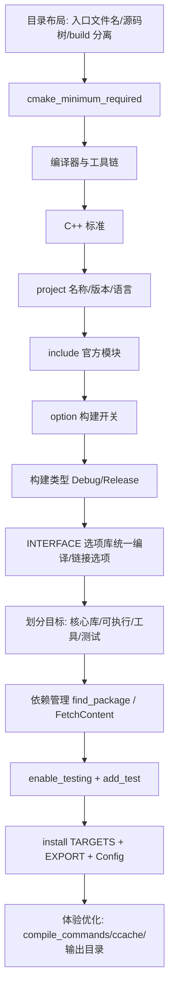

# 用 CMake 搭建 C++ 游戏服务器项目：必做的事

> 本文只讨论“搭骨架”阶段 CMake 要负责的事，不写任何游戏逻辑代码。
> 以本项目 `CppGameServer`（目标名 `CAS`）的现有配置为对照。

## 0. 先摆正三件“地基级”的事

这三件不算 CMake 语法，但**不做对，后面全部报错**，也是本项目前几轮实际踩过的坑。

| # | 要做的事 | 不做对的后果 |
|---|---------|-------------|
| 1 | 入口文件名**必须**是 `CMakeLists.txt`（大小写敏感） | Linux 下 `CmakeLists.txt` 无效，报 `does not appear to contain CMakeLists.txt` |
| 2 | **源码目录与构建目录分离**（out-of-source） | 在源码根直接 `cmake ..` 会污染仓库、且路径解析混乱 |
| 3 | 约定源码树布局：对外头文件 `include/`、内部实现 `Source/`、`src/` | 目标里写死的包含路径和真实目录对不上，编译找不到头文件 |

正确的构建姿势（只有两种）：

- `cmake -S . -B build`（推荐，显式指定源码树与构建树）
- `mkdir build && cd build && cmake ..`

清理方式永远是删掉整个 `build/` 目录，而不是手动删零散文件。

## 1. 声明最低 CMake 版本

**要做的事**：在**根目录入口文件的第一行**写 `cmake_minimum_required`。

**为什么**：它决定了后续所有命令/生成器表达式可用与否，也决定 CMake 是否开启“旧兼容行为”。低于需求版本应直接失败，而不是悄悄出错。

本项目现状：

```1:1:CMakeLists.txt
cmake_minimum_required(VERSION 3.25)
```

**要点**：版本号要写你**实际开发机上装的版本**，不要盲目抄高版本（会导致别人克隆下来配置失败）。服务器项目建议 ≥ 3.20，因为要用大量生成器表达式和 `cmake_path` 等新特性。

## 2. 选择编译器与工具链

**要做的事**：明确这个项目用哪个 C/C++ 编译器编译。

**两种方式**：

- 运行 cmake 时传入：`cmake -S . -B build -DCMAKE_CXX_COMPILER=g++-13`
- 在 CMakeLists 里默认（**必须在 `project()` 之前**，否则无效）

**要点**：

- 编译器设置必须放在 `project()` 之前，放后面会被忽略。
- **不要硬编码绝对路径**（如 `/usr/bin/gcc`）。不同机器、不同发行版、WSL 与容器里路径都可能不存在，一配置就失败；应退化为“未指定时才探测”。

本项目现状（有隐患，建议改）：

```3:6:CMakeLists.txt
# 强制指定 C/C++ 编译器
# 注意：如果 /usr/bin/gcc 或 /usr/bin/g++ 不存在，配置会失败
set(CMAKE_C_COMPILER "/usr/bin/gcc" CACHE FILEPATH "C compiler" FORCE)
set(CMAKE_CXX_COMPILER "/usr/bin/g++" CACHE FILEPATH "C++ compiler" FORCE)
```

## 3. 锁定语言标准

**要做的事**：统一 C++ 标准（游戏服务器现在普遍 C++17 / C++20），并声明是否强制、是否允许编译器扩展。

本项目现状：

```8:13:CMakeLists.txt
# 使用 C++20 标准
# CMAKE_CXX_STANDARD_REQUIRED ON 表示必须支持 C++20
# CMAKE_CXX_EXTENSIONS ON 表示允许 GNU 扩展，例如 -std=gnu++20
set(CMAKE_CXX_STANDARD 20)
set(CMAKE_CXX_STANDARD_REQUIRED ON)
set(CMAKE_CXX_EXTENSIONS ON)
```

**要点**：

- `CMAKE_CXX_STANDARD_REQUIRED ON`：编译器不支持就直接报错，而不是悄悄降级。
- `CMAKE_CXX_EXTENSIONS ON` = `-std=gnu++20`（可用 GNU 扩展）；如果要**跨平台一致性**（同一份代码要上 Windows/MSVC），应设为 `OFF` = `-std=c++20`。
- 游戏服务器经常依赖 GNU 扩展（`pthread`、原子操作、`__attribute__`），本项目选 `ON` 是合理的。

## 4. 用 `project()` 正式声明项目

**要做的事**：声明项目名、版本、支持的语言。

```15:16:CMakeLists.txt
# 定义项目：名称 CAS，版本 0.1.0，语言 C++ 和 C
project(CAS VERSION 0.1.0 LANGUAGES CXX C)
```

**要点**：

- 这一行之后 CMake 才会探测编译器、设置 `CMAKE_CXX_COMPILER_ID` 等关键变量。
- `VERSION` 会自动生成 `PROJECT_VERSION`、`CAS_VERSION_MAJOR` 等变量，**应该把它传给代码**（版本号、协议版本、日志前缀都要用），不要到处手写常量。
- `LANGUAGES` 显式列出，避免 CMake 去探测不需要的语言（比如 Fortran）。

## 5. 引入需要的 CMake 标准模块

**要做的事**：`include()` 官方模块，拿到现成的能力，不要自己造轮子。

本项目现状：

```18:22:CMakeLists.txt
# 引入 CMake 标准安装目录变量，例如 CMAKE_INSTALL_BINDIR
include(GNUInstallDirs)

# 引入包配置辅助函数，用于生成 CASConfig.cmake 等文件
include(CMakePackageConfigHelpers)
```

服务器项目常用模块：

| 模块 | 用途 |
|------|------|
| `GNUInstallDirs` | 标准化的 `bin/lib/include` 安装路径（适配不同发行版） |
| `CMakePackageConfigHelpers` | 生成 `xxxConfig.cmake`，让别人 `find_package(你的库)` |
| `FetchContent` | 拉取第三方源码依赖（后面第 10 条） |
| `CTest` / `enable_testing()` | 单元测试与 `ctest` 驱动 |
| `CheckCXXSourceCompiles` | 探测编译器特性（如是否支持 coroutine） |

## 6. 定义构建开关（`option`）

**要做的事**：把“可选构建”变成开关，让构建者按需裁剪，而不是改 CMakeLists。

本项目现状：

```24:27:CMakeLists.txt
# 构建选项
option(CAS_BUILD_EXAMPLES "Build Examples" ON)
option(CAS_BUILD_TESTS    "Build Tests"    ON)
option(CAS_BUILD_TOOLS    "Build Tools"    ON)
```

**要点**：

- 游戏服务器项目典型开关：`BUILD_TESTS`、`BUILD_TOOLS`（压测机器人/协议工具）、`BUILD_BENCHMARK`、`ENABLE_COVERAGE`、`USE_MYSQL`/`USE_REDIS`、`BUILD_SHARED_LIBS`。
- 用法：`cmake -S . -B build -DCAS_BUILD_TESTS=OFF`。
- **注意**：开关打开但对应目录是空的（本项目 `Tests/`、`Tools/` 的 CMakeLists 目前是 0 字节），配置虽然能过，但没有任何产出——建议先把默认关掉，等有内容再开。

## 7. 确定构建类型（Debug / Release）

**要做的事**：处理“单配置生成器”（Makefile/Ninja）与“多配置生成器”（VS/Xcode）的差异，并给出默认值。

本项目现状：

```29:41:CMakeLists.txt
# 对于单配置生成器（如 Makefile、Ninja），如果没有指定构建类型，默认设为 Debug
# 多配置生成器（如 Visual Studio、Xcode）不需要 CMAKE_BUILD_TYPE
if(NOT CMAKE_CONFIGURATION_TYPES AND NOT CMAKE_BUILD_TYPE)
    set(CMAKE_BUILD_TYPE Debug CACHE STRING "Choose the type of build." FORCE)
endif()

# 给 CMAKE_BUILD_TYPE 提供可选值，方便在 cmake-gui 或 ccmake 中选择
set_property(CACHE CMAKE_BUILD_TYPE PROPERTY STRINGS
    Debug
    Release
    RelWithDebInfo
    MinSizeRel
)
```

**要点**：

- `set_property(... STRINGS ...)` 只是给 GUI 提供下拉候选，不影响命令行。
- 服务器项目的实际用法：**开发 Debug，压测/上线 RelWithDebInfo**（既 `-O2` 又带符号表，方便线上崩溃回溯）。

## 8. 集中管理编译/链接选项（本项目做得最好的一点）

**要做的事**：**不要**在每个目录里散落 `-O2 -g -Wall`，而是建一个 **INTERFACE 库**作为“选项载体”，所有目标链接它即可继承全部选项。同时用**生成器表达式**区分编译器/平台/配置。

本项目现状（`Cmake/CASOptions.cmake`）：

- 警告与严格性：`-Wpedantic`、`-fno-strict-aliasing`
- Linux + GNU/Clang：`-fPIC`、`-rdynamic`
- Debug：`CAS_DEBUG` 宏、`-O0 -g3 -ggdb`
- Release / RelWithDebInfo：`-O2`、`-fno-omit-frame-pointer`、`NDEBUG`
- 可选：`ENABLE_COVERAGE` → `--coverage`

```36:40:Cmake/CASOptions.cmake
target_compile_options(CAS_options INTERFACE
    $<$<CONFIG:Debug>:-O0>      # 关闭优化，便于调试（注意是字母 O，不是数字 0）
    $<$<CONFIG:Debug>:-g3>      # 生成最多调试信息
    $<$<CONFIG:Debug>:-ggdb>    # 生成 GDB 专用调试信息
)
```

**为什么对游戏服务器尤其重要**：

| 选项 | 服务器场景的意义 |
|------|-----------------|
| `-rdynamic` | 崩溃时能打出**可读的调用栈符号**，否则 backtrace 全是地址 |
| `-fno-omit-frame-pointer` | `perf`/`bcc` 线上性能采样才能采到完整栈 |
| `-fno-strict-aliasing` | 网络收发、内存池、对象池里大量强转，避免 UB 被优化器吃掉 |
| `-fPIC` | 后续要做共享库/插件（脚本模块、协议模块）时的前置条件 |
| `--coverage` | 逻辑服关键模块（战斗结算、背包）的覆盖率统计 |

## 9. 划分目标（target）与目录

**要做的事**：按“产出物”划分目标，而不是按文件夹随意堆砌。CMake 的核心思维是 **Target + 属性传递**（`PUBLIC`/`PRIVATE`/`INTERFACE`）。

本项目现状：

```59:68:CMakeLists.txt
include(Cmake/CASOptions.cmake)

add_subdirectory(CAS)
if(CAS_BUILD_TESTS)
    enable_testing()
    add_subdirectory(Tests)
endif()
```

**游戏服务器典型目标划分**：

| 目标类型 | 例子 | 命令 |
|---------|------|------|
| 核心静态库 | `CAS`（逻辑、网络、协议） | `add_library(... STATIC)` |
| 选项接口库 | `CAS_options` | `add_library(... INTERFACE)` |
| 可执行文件 | `gameserver`、`gate`、`dbproxy` | `add_executable` |
| 工具 | 协议生成器、压测机器人、配置校验器 | `add_executable` |
| 测试 | 单元测试 | `add_executable` + `add_test` |

**要点**：

- 链接一律用 `target_link_libraries(A PRIVATE/PUBLIC B)`，不要用老的全局 `link_libraries`。
- 头文件路径用 `target_include_directories` + `$<BUILD_INTERFACE:...>` / `$<INSTALL_INTERFACE:...>` 这对生成器表达式，保证“构建时”和“安装后”都能用。
- **库必须至少有一个可编译的 `.cpp`**，否则就是本项目遇到过的 `No SOURCES` / `Cannot determine link language`。

## 10. 依赖管理

**要做的事**：把第三方依赖显式声明并接入目标，而不是靠系统里“碰巧装了什么”。

服务器项目常见依赖与接入方式：

| 依赖 | 典型用途 | 推荐接入 |
|------|---------|---------|
| `Threads::Threads` | 多线程 | `find_package(Threads REQUIRED)` |
| `OpenSSL` | 登录/支付 HTTPS、加密 | `find_package(OpenSSL)` |
| `Protobuf` / `flatbuffers` | 协议编解码 | `find_package` 或 `FetchContent` |
| `spdlog` / `fmt` | 日志 | `FetchContent` / `CPM` |
| `Boost.Asio` / `libuv` | 网络层 | `find_package` |
| `MySQL`/`Redis` client | 数据落地与缓存 | `find_package` 或 `pkg-config` |
| `Lua` / `sol2` | 脚本热更 | `FetchContent` |
| `GTest` / `doctest` | 单元测试 | `FetchContent`（测试专用） |

**要点**：

- 优先用**导入目标**（`OpenSSL::SSL`、`GTest::gtest`），它自带头文件路径和链接属性。
- 版本要**锁定**（`GIT_TAG`），否则 CI 上会拉到不兼容的新版本。
- 服务器项目强烈建议固定依赖版本，保证开发机 / CI / 线上构建产物一致。

## 11. 测试与 CTest

**要做的事**：开启测试并把可执行测试注册进 CTest。

- 根目录 `enable_testing()`（或 `include(CTest)`），本项目已在 `CAS_BUILD_TESTS` 分支里做了。
- 每个测试用 `add_test(NAME xxx COMMAND xxx)` 注册。
- 运行：`ctest --test-dir build --output-on-failure`。

## 12. 安装、导出与打包

**要做的事**：定义“构建产物怎么交付给运维/其他项目”。

本项目现状：

```59:64:CAS/CMakeLists.txt
install(TARGETS CAS
    EXPORT CASTargets
    ARCHIVE DESTINATION ${CMAKE_INSTALL_LIBDIR}
    LIBRARY DESTINATION ${CMAKE_INSTALL_LIBDIR}
    RUNTIME DESTINATION ${CMAKE_INSTALL_BINDIR}
)
```

**还差的一步**：`install(EXPORT CASTargets ...)` 目前是注释状态（第 75-80 行），不补上的话会报 “export set 未安装”，且外部项目无法 `find_package(CAS)`。

完整交付链要做三件事：

1. `install(TARGETS ... EXPORT ...)`
2. `install(EXPORT ... NAMESPACE CAS:: ...)` 生成 `CASTargets.cmake`
3. `configure_package_config_file` + `write_basic_package_version_file` 生成 `CASConfig.cmake` / `CASConfigVersion.cmake`

（这也正是第 5 条里 `include(CMakePackageConfigHelpers)` 的目的。）

## 13. 构建体验（可选但很值）

本项目已做的一件：

```45:57:CMakeLists.txt
# 查询当前服务器的逻辑 CPU 核心数
cmake_host_system_information(RESULT CPU_NUMS QUERY NUMBER_OF_LOGICAL_CORES)
message(STATUS "CPU NUMS on current server is: ${CPU_NUMS}")

# 计算并行编译线程数：约为逻辑核心数的 1.5 倍
# 注意 CMake 的 math 是整数运算，所以 1.5 倍会向下取整
math(EXPR JOBS "${CPU_NUMS} + ${CPU_NUMS} / 2")
```

**还建议加的**（服务器项目体量大，体验差别明显）：

- `CMAKE_EXPORT_COMPILE_COMMANDS ON` → 生成 `compile_commands.json`，clangd / IDE 跳转与补全才能正常工作。
- 统一输出目录：`CMAKE_RUNTIME_OUTPUT_DIRECTORY`、`CMAKE_LIBRARY_OUTPUT_DIRECTORY`、`CMAKE_ARCHIVE_OUTPUT_DIRECTORY`，避免产物散落在 `build/` 各处。
- `ccache`：`CMAKE_CXX_COMPILER_LAUNCHER`，大型项目重编提速非常明显。
- `CMAKE_BUILD_PARALLEL_LEVEL`（本项目已设，48 线程）让 `cmake --build` 默认并行。

## 14. 常见报错速查表

| 报错 | 真实原因 |
|------|---------|
| `does not appear to contain CMakeLists.txt` | 入口文件名大小写错 / 工作目录不对 |
| `Ignoring extra path from command line` | 在源码根直接跑 `cmake ..`，或根目录残留 `CMakeCache.txt` |
| `No SOURCES given to target: CAS` | 库目标的源文件列表为空 |
| `Cannot determine link language for target` | 目标里只有头文件，没有一个 `.cpp` |
| `export set "CASTargets" ... not installed` | 用了 `EXPORT` 但没写 `install(EXPORT)` |
| 找不到头文件 | 头文件没放在 `target_include_directories` 声明的目录下 |

## 15. 最小落地清单

按这个顺序做，一个能跑、能测、能交付的游戏服务器骨架就成型了：



## 16. 对照：本项目现状 vs 建议

| 项目 | 状态 |
|------|------|
| 入口文件名、构建目录分离 | 已修复 |
| 版本 / 标准 / project | 已完成 |
| INTERFACE 选项库 + 生成器表达式 | 已完成，质量不错 |
| 并行度 / 日志输出 | 已完成 |
| 编译器硬编码 `/usr/bin/gcc` | **建议改为探测式** |
| `CAS/Source/` 与 CMake 里写的 `src/`、`include/` 不一致 | **建议统一**（目前 `include/` 目录还不存在） |
| `Tests/`、`Tools/` 的 CMakeLists 为空但 option 默认 ON | **建议先置 OFF** |
| `install(EXPORT CASTargets)` 被注释 | **建议补上**，否则安装会失败 |
| 无 `compile_commands.json` / 统一输出目录 | 建议补 |
